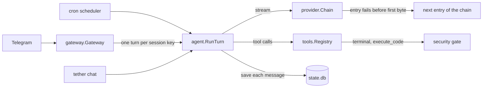

# How It Works

This page explains the inside of Tether Agent: the architecture, one turn of the agent, the
provider layer, the system prompt, memory, sessions, compaction, the database, and cost
tracking. It is for developers and for readers who want to know how a small agent works.

To install and use the agent, start with [Getting Started](Getting-Started).

## Architecture

Tether Agent is one static Go binary, `tether`. It has no runtime that you must install, and it
uses no C code (`CGO_ENABLED=0`). The binary has two roles:

- **`tether chat`** is an interactive chat in the terminal.
- **`tether gateway`** is the long-running service. It polls Telegram and runs the cron
  scheduler.

The two roles use the same data folder and the same database, `state.db`. A chat can run next to
the gateway. Only one gateway can run for each data folder, because the gateway holds a file
lock on `gateway.lock`.

### Packages

The code is in `internal/`. These are the main packages:

| Package | Job |
|---|---|
| `app` | Builds the program: config, database, providers, tools, MCP, and the agent. |
| `gateway` | Runs one turn for each session key, the queue, the steer, the slash commands, and the CLI channel. |
| `agent` | The turn loop, the system prompt, child runs, and background reviews. |
| `tools` | The tool registry and the built-in tools. |
| `config` | The config file, the defaults, and the table of provider presets. |
| `provider` | The adapters for the `openai`, `anthropic`, and `responses` wire formats, streaming, the fallback chain, the reasoning effort, and the model lists of `/model` with their cache. |
| `telegram` | The Telegram channel over the Bot API with plain `net/http`. |
| `cron` | The scheduler, the job runs, and the delivery of results. |
| `ctxmgr` | Compaction and the truncation of long tool output. |
| `memory` | The two memory files. |
| `skills` | The skill loader, the skill install, and the skill guard. |
| `security` | The approval gate, protected paths, and secret redaction. |

Other packages are smaller: `browser`, `mcp`, `media`, `sessions`, `pricing`, `obs` (logs and
usage), `db`, `backup`, `setup`, `update`, `hostos`, and `gatewaylock`.

## Message flow

1. A channel receives a message. Telegram goes through `gateway.Gateway`. `tether chat` uses one
   simple loop and reads input only between turns.
2. The gateway runs one turn at a time for each session key. When a turn runs for that key, a
   plain text goes into the running turn as a **steer**. Other messages, for example photos, wait
   in a queue. See [Commands](Commands#while-the-agent-is-busy).
3. `agent.RunTurn` runs the loop. It saves each message as soon as the message exists.
4. The tool registry runs the tool calls. The `terminal` tool and the script text of
   `execute_code` go through the approval gate. See [Security](Security).
5. The provider streams the answer back to the channel. The fallback chain goes to the next
   entry only when an entry fails before the first byte. See
   [The provider layer](#the-provider-layer).

`/now` or the **⚡ Do this now** button stops the running turn. The waiting steer then runs
first, and then the queue. `/stop` drops the waiting steer and clears the queue. See
[Commands](Commands#stop-or-take-over).

## One turn, step by step

1. **Choose the chain.** A `/model` pin of the session puts its entry first. Then come
   `primary` and the entries of `agent.fallback`. See [Fallback chain](#fallback-chain).
2. **Get the system prompt.** The prompt cache gives the frozen prompt of the session. See
   [System prompt](#system-prompt).
3. **Save the user message at once.** When the date changed after the prompt was frozen, the
   message gets a `[now: …]` prefix with the current time.
4. **Run the rounds.** Each round does these steps:
   1. Add any steer text that waits.
   2. Compact the context if it is too large. See [Compaction](#compaction).
   3. Build the request from the stored messages and stream the model call. The request
      carries the reasoning effort of the session and the entry that served the last call.
      When the stream sends no event for 300 seconds, the agent stops the call.
   4. Save the assistant message with its reasoning, its token counts, and its cost.
   5. When the answer has no tool calls, the text is the final answer and the turn ends.
   6. Else, run the tool calls. They run in parallel, up to `agent.tool_concurrency`, but only
      when each tool in the round is safe to run in parallel.
   7. Redact secrets in each tool result, then cut a result that is too long.
5. **Add a steer.** Steer text that arrives during a round goes to the end of the last tool
   result as `User guidance: …`. The model reads it in the next round.
6. **Stop at the round limit.** Before the last allowed round, the agent adds the note "Stop
   calling tools and give your final answer now." When the turn uses all rounds of
   `agent.max_turns`, the answer ends with `[stopped: max tool rounds reached]`.
7. **Stop on repeated failures.** Three failures of the same kind in a row end the turn, for
   example a call to an unknown tool or arguments that are not valid JSON.
8. **Start reviews.** After the turn, a background memory or skill review can start. See
   [Background reviews](#background-reviews).

When a restart cuts a turn, the gateway can continue the turn at the next start. See
[Running as a Service](Running-as-a-Service).

## The provider layer

The `provider` package sends each model call. It has no vendor SDK. It uses plain HTTP and
server-sent events (SSE). This section tells how the package works. To set up a provider, read
[Providers](Providers).

### Provider entries and adapters

Each entry under `providers:` is a **provider entry**. `config.Load` resolves the preset of each
entry first:

1. A **preset** fills an empty `format`, an empty `base_url`, and an empty `api_key`.
2. The key env of the preset applies only when the `base_url` is the URL of the preset. A preset
   key never goes to another host.
3. The quirks and the effort style of the preset also apply only on the URL of the preset.

`provider.New` then gives each entry an adapter for its **wire format**:

| Wire format | Adapter | Request | Reasoning that the adapter keeps |
|---|---|---|---|
| `openai` | `openai.go` | `POST {base_url}/chat/completions` | The `reasoning_content` text. Only an entry with the quirk `reasoning_content` keeps it. |
| `anthropic` | `anthropic.go` | `POST {base_url}/v1/messages` | The `thinking` and `redacted_thinking` blocks. |
| `responses` | `responses.go` | `POST {base_url}/responses` | All output items of the response, with the encrypted reasoning. |

The **primary provider** is the entry `primary`. An entry is not complete in two cases:

- It has no `model`.
- It has a preset, but the entry gets no API key.

An entry with no preset and no API key is complete. Its calls go with no auth header, for
example to a local server.

When `primary` is not complete, the load stops. Another entry that is not complete loads as an
unusable entry:

- Its adapter fails each call before the first byte. It makes no network call.
- The fallback chain then goes to the next entry.
- `app.New` logs `provider entry is not usable` with the cause.

The `responses` adapter sends `store: false` and the full history on each call. The provider
keeps no copy of the conversation, so `state.db` stays the only record.

### Streaming

Each call is one POST request that streams its answer. The adapter reads the SSE stream in a
goroutine and sends events on a channel:

- A text delta goes to the channel at once. The agent streams it to Telegram or to the
  terminal.
- A tool call goes to the channel when its arguments are complete.
- The last event is a done event, with the finish reason, the token counts, and the reasoning.
  An error event replaces it when the stream fails.

Each event carries a stamp: the name of the provider entry and the model that served the call.
The agent saves the stamp with the message. A stream that stops early still names its entry,
because each event has the stamp.

These rules apply to each stream:

- A stream that ends before its finish event is an error.
- The agent stops a call when the stream sends no event for 300 seconds.
- After an error, the agent saves the partial text. It does not save the tool calls of a failed
  stream, because they have no result.
- An HTTP error keeps the first 512 bytes of the body, on one line. The adapter removes the API
  key from the error text.
- After a cancel, the adapter waits a maximum of 2 seconds to send its last event. Then the
  goroutine stops.

### Fallback chain

Each model call goes through a **fallback chain** of provider entries. The order of the chain is:

1. The entry of the `/model` pin, if the session has a pin.
2. `primary`.
3. The entries of `agent.fallback`, in their order.

A name occurs only one time in the chain. When `agent.fallback` is absent, an entry with the name
`fallback` is the only fallback entry. `agent.fallback: []` turns off the fallback. A pin
`<name>:<model>` changes the model of the first entry only. The other entries use their own
models.

The chain goes to the next entry only when a call fails before the first byte of the answer.
These failures count:

- a connection error
- HTTP 5xx, 429, 401, 402, 403, or 408
- an HTTP 400 whose body tells of a billing or quota failure
- an unusable entry

Another error goes to you, because a bad request fails on each provider. A cancel also returns
at once. After the first byte, no other entry gets the call. The log shows each change of entry
as `provider fallback`. When all entries fail, the error holds the error of each entry.

**Wait time.** An entry that fails gets a wait time of 60 seconds for its model. In that time,
the chain skips it. When all entries wait, the chain tries all of them. The state is in
`provider.Health`:

- The key of the state is the entry and the model. A failure of a pinned model does not mark the
  other models of the entry.
- All sessions share one `Health`, because the state describes a provider, not a session.
- The state is in memory, so a restart clears it.
- A call that works clears the failure of its entry.

`/new` and `/model` read this state. In the 60 seconds after the first entry of the chain
failed, they show the entry that serves the calls now. They also show a ⚠️ line with the cause.
After the wait time, they show the first entry again. See [Commands](Commands#model-and-effort).

**One turn stays on one entry.** The next call of the turn starts at the entry that served the
last call. The chain then tries the entries after it, and then the entries before it. A new
turn starts at the first entry again. The reasoning replay needs this rule. See
[Reasoning content](#reasoning-content).

**Who uses which chain.**

| Caller | Provider |
|---|---|
| A turn and its compaction | The chain of the session. |
| A `delegate_task` child run | The chain that starts at `agent.delegation_provider`. When the key is `""`, the chain of the parent session. |
| A background review | The chain of the parent session. The review session copies the `/model` pin of the parent. |
| A cron run | The chain that starts at the model pin of the job. A job with no pin uses the default chain. |
| The judge of the `smart` approval mode | The default chain, which starts at `primary`. |
| `view_image` with no `agent.vision_provider` | The default chain, only when `primary` has `vision: true`. Only the entries with `vision: true` get the call. When `primary` has no vision, the agent does not register `view_image`. |
| `view_image` with `agent.vision_provider` | That entry only, with no fallback chain. |
| A media tool with the `endpoint` backend | That entry only, with no fallback chain. |

### Reasoning effort

The **reasoning effort** of a turn call comes from the first source that has a value:

1. The `/effort` level of the session, in the `sessions.effort` column.
2. The `effort` of the provider entry that gets the call.
3. No value. The adapter sends no effort field, and the provider default applies.

For this reason, a fallback entry uses its own `effort`, unless the session has an `/effort`
level. A child run and a forked session copy the level of the parent.

Other calls do not use the `/effort` level. These calls use the `effort` key of the entry that
gets the call, else no value:

- the compaction summary
- the judge of the `smart` approval mode
- `view_image`

The levels are `none`, `minimal`, `low`, `medium`, `high`, `xhigh`, and `max`. The effort style
of the preset tells the adapter how to send a level. The adapter changes the level to the
nearest level that the provider accepts. An entry with no preset uses the standard field of its
wire format:

| Wire format | Standard field |
|---|---|
| `openai` | `reasoning_effort` |
| `responses` | `reasoning.effort` |
| `anthropic` | `output_config.effort` |

The `anthropic` adapter never asks for thinking itself. [Providers](Providers#reasoning-effort)
gives the map for each preset.

**A model that rejects the level.** Some models reject an effort field with an HTTP 400. When the
body of the 400 contains `effort`, `reasoning`, or `thinking`, the chain sends the call one more
time with no effort field. When that call works, these things occur:

- The log shows a warning.
- `Health` records that the entry and the model reject the effort.
- Later calls to that entry and model send no effort, until a restart.

The retry marks no failure, so the entry gets no wait time. When the retry also fails, the
chain records no rejection, because the 400 can have another cause. The error of the retry then
follows the normal rules of the fallback chain.

The effort is not part of the system prompt. A change of `/effort` does not build the prompt
again.

### Reasoning content

Some models return their reasoning with the answer. Each adapter collects it in a
`provider.Reasoning` value:

- **`issuer`** is `<wire format> <base_url> <model>` of the call.
- **`text`** is the `reasoning_content` text of the `openai` wire format.
- **`output`** holds the thinking blocks of the `anthropic` wire format, or all output items of
  the `responses` wire format. The adapter keeps them as compact JSON, in stream order.

The reasoning never goes to you as answer text. The agent saves it with the assistant message,
in the `messages.reasoning` column as JSON. A cell with bad JSON loads as no reasoning, so one bad
cell does not block a session.

**Replay.** On the next call, an adapter sends the stored reasoning back only to its issuer: the
same wire format, base URL, and model. Another entry does not get it. Each adapter has one more
rule:

- `openai` with the quirk `reasoning_content` sends the stored text. A message with no stored
  text from this issuer gets one space, because DeepSeek and Kimi need the field on each
  assistant message.
- `anthropic` puts the stored thinking blocks before the text and the tool calls. It drops a
  block with bad JSON.
- `responses` sends the stored output items unchanged and in order. It drops a last reasoning
  item that has no item after it, because the API rejects it.

These parts of the program also handle the reasoning:

- The token estimate of compaction counts the reasoning, because the next call can send it
  again.
- `/fork` copies the reasoning with the messages.
- `tether sessions export` leaves the reasoning out.
- A backup masks known secret values in the reasoning column. See [Security](Security#backups).

### Images

An entry with `vision: false` gets the messages with no images. The `[image: <path>]` text stays,
so the model can call `view_image`. A call that has no use without its images, for example
`view_image`, skips each entry with no vision. When no entry of the chain has vision, the call
fails.

## System prompt

The agent builds the system prompt from these parts, in this order. A part with no content has
no header.

1. **Base prompt.** It is embedded in the binary. It tells the model who it is and how to work.
   `/prompt set <text>` replaces it for one session, and `/prompt clear` restores it.
2. **`## MEMORY`**: the content of `memory/memory.md`.
3. **`## USER PROFILE`**: the content of `memory/user_profile.md`.
4. **`## SKILLS`**: one line for each skill, with its name and description.
5. **`## TOOL NOTES`**: short fixed notes for some tools, when those tools are visible.
6. **Context**: the date and time, the time zone, the working directory, the channel, and the
   chat.

There is no persona file. To change the behavior, edit the memory files, write a skill, or use
`/prompt set`.

### Why the prompt stays the same

The providers have a **prompt cache**. A request that starts with the same bytes as an earlier
request costs less and starts faster. For this reason, the system prompt of a session stays
byte-stable.

The prompt cache of Tether Agent keys a prompt by these values:

- the session
- the model pin
- the prompt override
- the compaction count
- the MCP generation

Nothing else builds the prompt again. The reasoning effort and the fallback state are not part
of the key. An edit to memory or skills does not change a prompt that already exists. The edit
shows in these cases:

- a new session (`/new`)
- after a `/model` or `/prompt` change, because both are part of the key
- after a restart of the process, because the cache is only in memory
- after a compaction
- after `/reload-mcp`

The adapters also help the provider prompt cache:

- The `anthropic` adapter puts a `cache_control` marker on the last 3 messages. The system
  prompt and the tools are part of the cached prefix of each marker.
- The `responses` adapter sends the session id as `prompt_cache_key` on the `openai` and `xai`
  presets. The `xai` preset also sends it in the `x-grok-conv-id` header.
- The request body of each adapter has a fixed field order, so the same history gives the same
  bytes.

## Memory

Memory is two plain text files in the data folder:

| File | Content | Limit |
|---|---|---|
| `memory/memory.md` | Notes of the agent: facts about the environment, projects, and lessons. | 2200 characters |
| `memory/user_profile.md` | Facts about you: name, preferences, and habits. | 1375 characters |

A line that holds only `§` separates two entries. You can read and edit the files with any text
editor.

The agent changes memory with the `memory` tool. The tool has three actions:

- `add` adds an entry. When the file is full, the action fails and lists the current entries,
  so the model can remove or join entries.
- `replace` finds an entry by a unique part of its text and replaces it.
- `remove` finds an entry by a unique part of its text and removes it.

The writes are atomic and use a file lock. A memory change shows in the system prompt from the
next session. See [Why the prompt stays the same](#why-the-prompt-stays-the-same).

The `session_search` tool searches all past sessions with SQLite full text search. The agent uses
it to find an old conversation.

## Background reviews

After some turns, a background review looks at the conversation and saves what is useful:

- A **memory review** starts after each `memory.review_interval_turns` user turns (default 10).
- A **skill review** starts after each `skills.review_interval_tool_rounds` tool rounds
  (default 10). It can write a new skill or fix a skill.
- When both are due, they run as one review.
- A review also runs before a compaction and on `/new`, when the session has 6 or more user
  turns.

A review is a copy of the conversation in a separate `review` session. It sends the same tool
schemas as its parent and the session id of its parent as the cache key, so the prompt cache
hits. It can use only the `memory`, `skill_view`, and `skill_manage` tools. You see a short
notice after the answer, for example `💾 Memory updated` or `🧩 Skill created: <name>`.

Cron runs, child runs, and reviews do not start reviews.

## Child runs

`delegate_task` starts child runs. `agent.RunChild` runs each child as one turn in a new
`subagent` session:

- The child session copies the channel data and the reasoning effort of the parent. It has no
  session key, so no channel makes it active.
- The model pin of the child is `agent.delegation_provider`. When the key is `""`, the child
  gets the pin of the parent. The child chain then follows the normal
  [fallback chain](#fallback-chain) rules.
- The child gets a short, focused system prompt, not the prompt of the parent.
- The child cannot call the tools in `agent.ChildBlockedTools`: `delegate_task`, `clarify`,
  `memory`, `execute_code`, and `cronjob`. An orchestrator child can call `delegate_task` when the
  depth limit permits it.
- The toolsets of the child can only be smaller than the toolsets of the parent.
- `delegation.max_iterations` limits the rounds, and `delegation.child_timeout_s` limits the
  time.
- A child of a cron run follows `approvals.cron_mode`, because no user is present.

The parent gets the summary of each child, with its status and its number of tool calls. After
a timeout or a cancel, the summary holds the partial text. See [Tools](Tools#delegation).

## Sessions

A session is one conversation. Each session has a kind:

| Kind | Source |
|---|---|
| `chat` | `tether chat` or a Telegram chat. |
| `cron` | One cron run. |
| `subagent` | One `delegate_task` child run. |
| `review` | One background review. |

A **session key** names the place where a conversation occurs. Each key points to its current
session. Examples of keys:

- `cli:<os user>` for `tether chat`.
- `telegram:dm:<chat>` for a Telegram direct message.
- `telegram:group:<chat>[:<thread>][:<user>]` for a Telegram group.

`/new` starts a new session on the same key. `/sessions`, `/resume`, and `/fork` move between
sessions. See [Commands](Commands).

The gateway deletes `cron`, `subagent`, and `review` sessions after `sessions.retention_days`
(default 90). Chat sessions always stay.

## Compaction

A long session can become larger than the context window of the model. Compaction makes it
smaller.

- **When:** before each model call, the agent estimates the size of the request. The estimate
  counts the text, the tool call arguments, and the stored reasoning. When the size is more
  than `context.compact_threshold` (default 0.5) of the context window, compaction
  starts. `/compact` starts it at once.
- **What stays:** the first 3 and the last 20 messages stay as they are. Compaction never splits
  a tool call from its result.
- **What changes:** the chain of the session writes a structured summary of the messages in
  the middle. The summary has parts such as the active task, the goal, and the constraints. An
  earlier summary goes into the new summary, so early facts are not lost.
- **Storage:** the stored messages never change. A row in the `compactions` table replaces a
  range of messages with the summary in the view that goes to the model.
- **Failures:** after 3 failures in a row, you see a warning.

### Long tool output

A tool output longer than `context.tool_output_max_chars` (default 50000) keeps its head and its
tail. The full text goes to a spill file in `cache/spill/`. The program deletes spill files after
`context.spill_retention_days` (default 7).

## Database

`state.db` is a SQLite database. The driver is pure Go (`modernc.org/sqlite`), so the binary
needs no C library. The database uses WAL mode and one connection.

Migrations are SQL files in `internal/db/migrations/`. They are embedded in the binary and apply
in name order when the program opens the database:

- `001_init.sql` makes the main tables.
- `002_turn_markers.sql` adds the `turn_markers` table.
- `003_reasoning_effort.sql` adds `messages.reasoning` and `sessions.effort`.

Do not run a second query while the rows of a query are open. The database has one connection,
so the second query waits for ever.

| Table | Content |
|---|---|
| `sessions` | One row for each session: kind, key, title, model pin, prompt override, and reasoning effort. |
| `messages` | Each message, with tool calls, reasoning, token counts, latency, cost, model, and provider entry. |
| `messages_fts` | The full text index for `session_search`. |
| `compactions` | The summaries that replace ranges of messages. |
| `cron_jobs` | The scheduled jobs. |
| `approvals_always` | The commands that you approved with "always". |
| `pairing` | Telegram pairing codes and approved users. |
| `active_session` | The current session of each session key. |
| `delegation_batches` | Background `delegate_task` batches. |
| `turn_markers` | The running turns, so that a restart can continue them. |
| `kv` | Small values, for example the Telegram update offset and the home chat. |

## Cost tracking

The agent saves usage data with each assistant message:

- input tokens, output tokens, and cache read tokens
- latency to the first token and total latency
- the model and the provider entry that answered
- the cost in USD

The agent calculates the cost when it saves the message. It does not calculate it again later.
The cost is empty only when the price is not known. A plan entry, for example the Z.AI Coding
Plan, also gets the API price.

The agent looks for a price in this order:

1. `pricing.overrides` in the config.
2. The OpenRouter price data, only for a `base_url` on `openrouter.ai`.
3. The LiteLLM price data. The agent tries `price_key`, then the model name with a host prefix,
   then the model name alone.

The program keeps the price data in `cache/prices.json` and downloads it again each 24 hours. The
download does not block a turn.

To see the usage, use one of these commands:

- `tether usage [today|7d|30d]` in a terminal.
- `/usage [today|7d|30d|session]` in a chat.

## Heavy parts start late

Some parts use much memory or start a process. Tether Agent starts them only on the first call,
and it stops them when they are idle:

| Part | Starts | Stops |
|---|---|---|
| Browser (Chrome) | At the first browser tool call. | After `browser.idle_close_minutes` (default 10). |
| MCP server | At the first call to one of its tools. | After `idle_stop_minutes` (default 10). |
| Media programs | At each call. | When the call ends. |

At startup, the MCP tools come from a cache on disk, so most MCP servers do not start. Only a
server with no cache file (once, to list its tools) and an `always_on` server start at
startup.

This design has two reasons:

- **Idle cost.** A feature that you configure but do not use costs almost nothing. The gateway
  can run all day on a small server.
- **Startup time.** The program must start fast. A test, `TestStartupUnder100ms`, builds the
  binary and checks that it starts in less than 100 ms. For this reason, startup does no network
  work.
